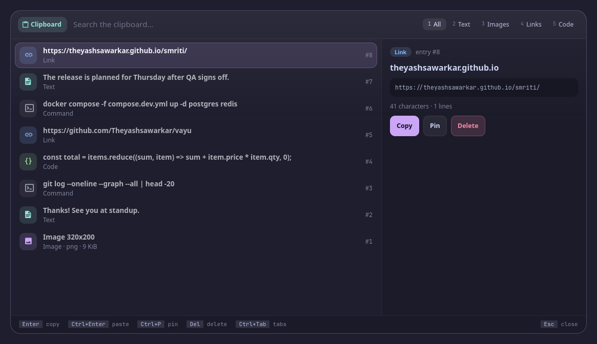

<p align="center">
  <picture>
    <source media="(prefers-color-scheme: dark)" srcset="assets/banner-dark.svg">
    <source media="(prefers-color-scheme: light)" srcset="assets/banner-light.svg">
    
  </picture>
</p>

<!-- identity -->
<p align="center">
  <b>नष्टो मोहः स्मृतिर्लब्धा त्वत्प्रसादान्मयाच्युत ।<br>
  स्थितोऽस्मि गतसन्देहः करिष्ये वचनं तव ॥</b><br>
  <i>Confusion is gone and memory regained; I stand free of doubt.</i><br>
  <sub>Bhagavad Gītā 18.73</sub>
</p>
<!-- /identity -->

<p align="center">
  <b>Clipboard history (cliphist): grouped by time, links, images, code and commands told apart by colour, thumbnails, a full preview, pins.</b><br>
  Clipboard history. A tool for <a href="https://github.com/Theyashsawarkar/vyom">Vyom</a>, keyboard-driven panels for Wayland.
</p>

<p align="center">
  <a href="https://github.com/Theyashsawarkar/smriti/actions/workflows/ci.yml"></a>
  <a href="https://github.com/Theyashsawarkar/smriti/releases"></a>
  <a href="LICENSE"></a>
  <a href="https://github.com/Theyashsawarkar/vyom"></a>
  
  
</p>

<!-- No screenshot: clipboard shows personal data (your own clipboard). -->

<p align="center">
  
</p>
<p align="center"><sub>Screenshots use made-up demo data.</sub></p>

> *Smriti* (स्मृति) is Sanskrit for "memory": everything you copied, remembered.

smriti is clipboard history for [Vyom](https://github.com/Theyashsawarkar/vyom): one keyboard-driven panel that opens instantly, with live data, a preview and a key for everything. It runs on any compositor with the layer-shell protocol (sway, Hyprland, river, niri, Wayfire, labwc…). In [Vayu](https://github.com/Theyashsawarkar/vayu), the desktop it was built for, it replaces `cliphist list | wofi --dmenu`.

## Contents

- [Features](#features)
- [Install](#install)
- [Usage](#usage)
- [Configuration](#configuration)
- [Troubleshooting](#troubleshooting)
- [The Vyom family](#the-vyom-family)
- [Contributing](#contributing)
- [License](#license)

## Features

- Your cliphist history **grouped by when you copied it**: Pinned, Just now, Today, Yesterday, Older, with an age on every row.
- Each entry recognised as a **link, image, code, command, email or text**, each with its own colour and icon (link blue, code green, command peach, image mauve, text teal), and a filter tab for each in the same colour.
- **Images as thumbnails** right in the list, links with their site, code and commands in a monospace font.
- A full preview: the whole text (not cliphist's cut-off line), **code with syntax colours**, how long ago you copied it.
- `Enter` copies; `Ctrl+Enter` copies and pastes into the window you were in.
- **Pin** what you reuse (`m`); delete what shouldn't be kept (`d d`, which asks first: it can't be undone).
- cliphist keeps no times, so smriti notes them while Vyom runs (it watches the clipboard with `wl-paste --watch`); entries from before that are under Older.
- Keyboard first: every action has a key, shown in the footer; the mouse works too.
- Never freezes the panel: slow commands run in the background.

## Install

### Requirements

- [Vyom](https://github.com/Theyashsawarkar/vyom) 0.6.0 or newer (Python 3.11+, PyGObject, GTK 4, [gtk4-layer-shell](https://github.com/wmww/gtk4-layer-shell), a Nerd Font)
- `cliphist`, `wl-copy` (and `wl-paste`, to note when you copied each entry)
- optional: wtype (Ctrl+Enter paste)

### Install

```sh
git clone https://github.com/Theyashsawarkar/smriti ~/.local/share/vyom/plugins/smriti
vyom reload           # pick it up (or log out and in)
vyom smriti            # open it; run it again to close
```

Give it a key in your compositor, e.g. sway:

```sh
bindsym $mod+<key> exec vyom smriti
```

### Update and uninstall

```sh
git -C ~/.local/share/vyom/plugins/smriti pull && vyom reload     # update
rm -rf ~/.local/share/vyom/plugins/smriti && vyom reload          # uninstall
```

## Usage

Open it with `vyom smriti` (or your key). It opens in insert mode: type to search. `Esc` goes to normal mode, where every key is a command and `Space` is the leader (a strip shows what comes next); `i` or `/` types again. The footer always shows the keys for what's selected.

<!-- KEYS (generated by scripts/keybinds.py from smriti/vim.py) -->

Vyom's keys work too (every vim tool has them): `?` and `Space ?` list every key, `Space Space` is the palette, `j` / `k` move, `gg` / `G` jump, `/` searches again, `H` / `L` switch tabs, `q` closes, `Space u f` is fullscreen, `Esc` steps back.

**Insert mode (typing; smriti opens in it)**

| Key | Action |
|---|---|
| `Enter` | Copy the selected entry |
| `Ctrl+Enter` | Paste the selected entry (copies it, then pastes into your window) |

**Normal mode**

| Key | Action |
|---|---|
| `Enter` | Copy the selected entry and close |
| `p` | Paste the selected entry into your window |
| `y y` | Copy the selected entry and stay open |
| `m` | Pin or unpin the selected entry |
| `d d` | Delete the selected entry (a pinned one: unpin it; asks first) |

**Both modes**

| Key | Action |
|---|---|
| `Ctrl+P` | Pin or unpin the selected entry |

**Leader (Space)**

| Key | Action |
|---|---|
| `Space y y` | Copy the selected entry and stay open |
| `Space y p` | Copy the selected entry's text, trimmed |
| `Space m p` | Pin or unpin the selected entry |
| `Space d d` | Delete the selected entry (asks first) |
| `Space d a` | Clear the whole history; pins stay (asks first) |
| `Space o b` | Open the selected link in the browser |
| `Space o e` | Open the selected entry in $EDITOR |

<!-- END KEYS -->


## Configuration

Everything is optional, in `~/.config/vyom/config.toml` under `[plugin.smriti]`:

| Setting | Default | What it does |
|---|---|---|
| `track_times` | true | Watch the clipboard to note when each entry was copied (`false`: no watcher; entries get the time smriti first listed them) |

Run `vyom reload` after editing.

## Troubleshooting

- **Nothing opens.** `vyom list` shows every installed tool, and why one is skipped (a missing requirement, or a Vyom that's too old).
- **It opened, then something failed.** Look for a `Traceback` in the daemon's log, `journalctl --user -u vyom -u vyom-daemon -b` (without systemd: `~/.local/state/vyom/daemon.log`), and [open an issue](https://github.com/Theyashsawarkar/smriti/issues/new/choose) with it.
- **No blur or rounded corners.** That's the compositor: on SwayFX, add `layer_effects "vyom" { blur enable; corner_radius 20; shadows enable }`.

## The Vyom family

Each tool is its own repository, so you install only the ones you want:

| Tool | | What it does |
|---|---|---|
| [dvara](https://github.com/Theyashsawarkar/dvara) | द्वार, gateway | The app launcher |
| [ganit](https://github.com/Theyashsawarkar/ganit) | गणित, mathematics | The calculator and converter |
| [smriti](https://github.com/Theyashsawarkar/smriti) (this one) | स्मृति, memory | Clipboard history |
| [bhava](https://github.com/Theyashsawarkar/bhava) | भाव, feeling, emotion | The emoji picker |
| [tarang](https://github.com/Theyashsawarkar/tarang) | तरंग, wave | Wi‑Fi and the hotspot |
| [setu](https://github.com/Theyashsawarkar/setu) | सेतु, bridge | Bluetooth |
| [doot](https://github.com/Theyashsawarkar/doot) | दूत, messenger | Your phone, through KDE Connect |
| [patra](https://github.com/Theyashsawarkar/patra) | पात्र, vessel | Docker containers |
| [akashvani](https://github.com/Theyashsawarkar/akashvani) | आकाशवाणी, voice from the sky | Notifications |
| [raga](https://github.com/Theyashsawarkar/raga) | राग, melody | YouTube music and video |
| [mudra](https://github.com/Theyashsawarkar/mudra) | मुद्रा, gesture | Keybinding search |
| [urja](https://github.com/Theyashsawarkar/urja) | ऊर्जा, energy | The battery at a glance |
| [vishram](https://github.com/Theyashsawarkar/vishram) | विश्राम, rest | The power menu |
| [kendra](https://github.com/Theyashsawarkar/kendra) | केन्द्र, centre | Quick settings |

## Contributing

Bug reports, ideas and pull requests are welcome: see [CONTRIBUTING.md](CONTRIBUTING.md) for the development setup and the few rules every tool follows, and [CHANGELOG.md](CHANGELOG.md) for what changed in each release. Please report security issues privately ([SECURITY.md](SECURITY.md)).

## License

[MIT](LICENSE).
